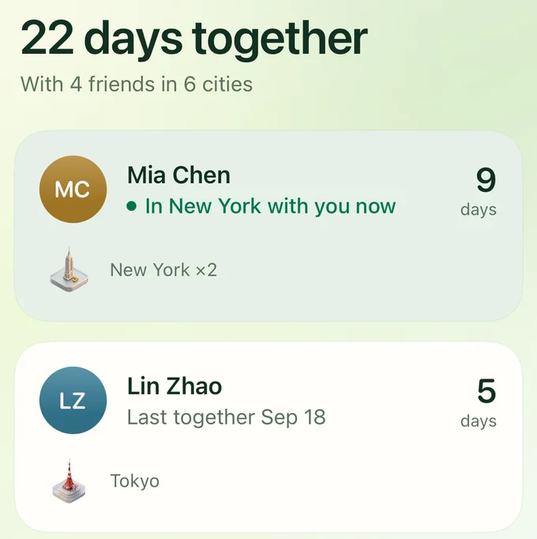
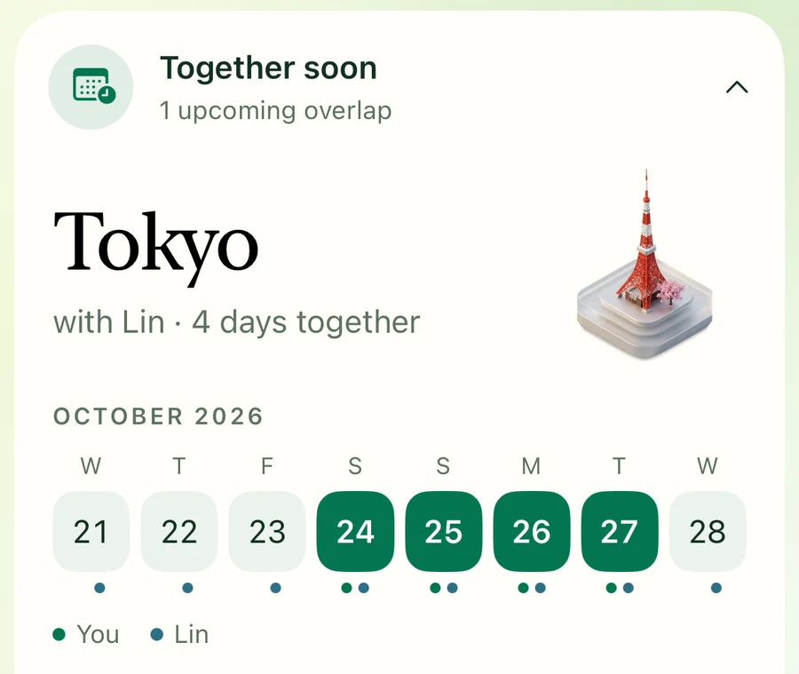
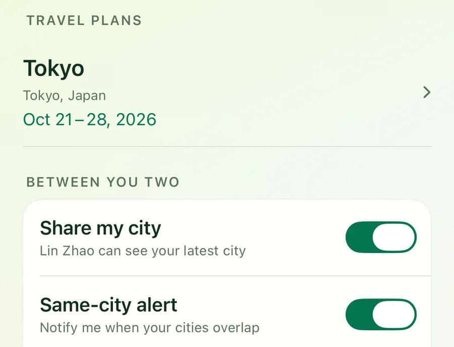
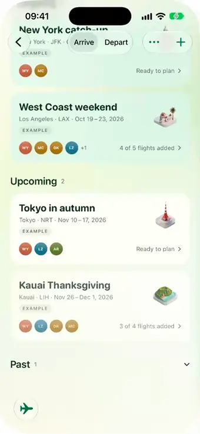
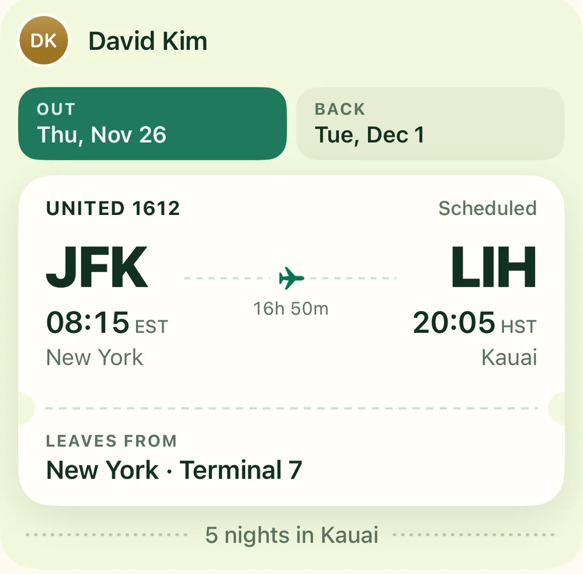

<div align="center">


# Across Us

**See you somewhere.**

Friends’ cities, overlapping plans and group trips, in one quiet iPhone app.

<a href="https://apps.apple.com/app/apple-store/id6807634842?pt=128897130&ct=github_readme&mt=8"></a>
<a href="https://acrossus.app"></a>


<sub><b>English</b> · <a href="README.zh-CN.md">简体中文</a></sub>

<br>


<br><br>


<sub>200+ cities, each with its own emblem.</sub>

</div>

<br>

## Friends move.

Across Us keeps their cities, plans and flights in one place, so a chance to meet doesn’t slip past. No live map, no GPS trail: just the city each friend chose to share, and when they shared it.

<table>
  <tr>
    <td width="33%" valign="top">
      
      <h3>All the days you shared a city</h3>
      Your time together, friend by friend, and who’s in town with you now.
    </td>
    <td width="33%" valign="top">
      
      <h3>Same city. Same dates.</h3>
      Together soon shows the days your plans overlap.
    </td>
    <td width="33%" valign="top">
      
      <h3>Their next stop, your call</h3>
      See a friend’s travel plans, and choose who sees your city and who can trigger an alert.
    </td>
  </tr>
</table>

## Everyone lands together.

Invite friends to a **Trip** and watch every flight land where you’re meeting.

<p align="center">
  
  &nbsp;
  
</p>

- **Every flight, one tap away.** Tap anyone for their boarding pass: local times, terminal and the flight home. Each traveler manages their own.
- **A nudge when it helps.** Flight-change alerts, morning reminders, and a tap to remind a friend who hasn’t added their flight.
- **Room for plans to change.** Members can leave; the creator can remove members or delete the Trip.

## On your Home Screen.

<p align="center">
  <picture>
    <source media="(prefers-color-scheme: dark)" srcset="site/assets/product/friends-dark.webp">
    
  </picture>
  &nbsp;
  <picture>
    <source media="(prefers-color-scheme: dark)" srcset="site/assets/product/here-together-dark.webp">
    
  </picture>
</p>

## Private by design.

<table>
  <tr>
    <td width="50%" valign="top">
      <h3>🏙️ City, not coordinates</h3>
      Apple’s location services resolve your city. Precise coordinates never reach our servers, and there is no continuous GPS trail.
    </td>
    <td width="50%" valign="top">
      <h3>🤝 Both sides agree</h3>
      Friendships are mutual. You choose, per friend, who sees your city and plans, and can pause sharing at any time.
    </td>
  </tr>
  <tr>
    <td width="50%" valign="top">
      <h3>🚫 No ads, no tracking</h3>
      No advertising, no cross-app tracking, no selling of personal data.
    </td>
    <td width="50%" valign="top">
      <h3>🗑️ Yours to delete</h3>
      Remove a friend, block someone, or delete your account from inside the app.
    </td>
  </tr>
</table>

Full policy: [acrossus.app/privacy](https://acrossus.app/privacy/)

---

## Under the hood

| Layer | Stack |
| --- | --- |
| **App** | SwiftUI · WidgetKit (small, medium, large) · iOS 18+ · English and 简体中文 |
| **Backend** | Supabase Postgres with versioned migrations · Edge Functions: `api`, `push-worker`, `trip-worker`, `ops-monitor` |
| **Notifications** | APNs, delivered per device from an outbox with retries |
| **Flights** | AeroDataBox lookups and status refresh |
| **Web** | [acrossus.app](https://acrossus.app) on Cloudflare Pages, with Pages Functions for invite links and Universal Links |
| **CI** | GitHub Actions: backend tests, Debug / Staging / Release builds, unit tests |

```text
WhereIsMyFriend/          SwiftUI app: App, Core, Features (Friends, Trips, TravelPlans, …)
WhereIsMyFriendWidget/    WidgetKit extension
WhereIsMyFriendTests/     Unit tests
WhereIsMyFriendUITests/   UI tests
supabase/                 Migrations, Edge Functions, seed, backend tests
site/  functions/         acrossus.app and its Pages Functions
docs/                     Design spec, API contract, release notes, reviews
```

## Run it locally

You’ll need **Xcode 27** (iOS 27 SDK). The app deploys to iOS 18 and later.

1. Open `WhereIsMyFriend.xcodeproj`.
2. Pick the **WhereIsMyFriend** scheme and any iPhone simulator.
3. Build and run.

Debug builds run on a local demo repository, so the whole app works without a server. Pass `-useRemoteAPI` to talk to a configured backend instead.

```bash
npm ci && npm run backend:test
```

```bash
xcodebuild -project WhereIsMyFriend.xcodeproj -scheme WhereIsMyFriend \
  -sdk iphonesimulator -destination 'generic/platform=iOS Simulator' \
  CODE_SIGNING_ALLOWED=NO build
```

<details>
<summary><b>Further reading</b></summary>

<br>

- [Design spec](docs/DESIGN_SPEC.md)
- [Client architecture decision](docs/ADR-001-CLIENT-BOUNDARY.md)
- [REST API contract](docs/API_CONTRACT.md)
- [Database schema](docs/DATABASE_SCHEMA.sql)
- [Supabase production plan](docs/SUPABASE_PRODUCTION_PLAN.md)
- [Optional local Supabase backend](docs/LOCAL_BACKEND.md)
- [TestFlight release](docs/TESTFLIGHT_RELEASE.md)
- [Product plan](PLAN.md)

</details>

<br>

<div align="center">


**Your friends are out there. Make room for the next hello.**

<sub>[Website](https://acrossus.app) · [App Store](https://apps.apple.com/app/apple-store/id6807634842?pt=128897130&ct=github_readme&mt=8) · [Privacy](https://acrossus.app/privacy/) · [Support](https://acrossus.app/support/)</sub>

<sub>© 2026 Across Us</sub>

</div>
