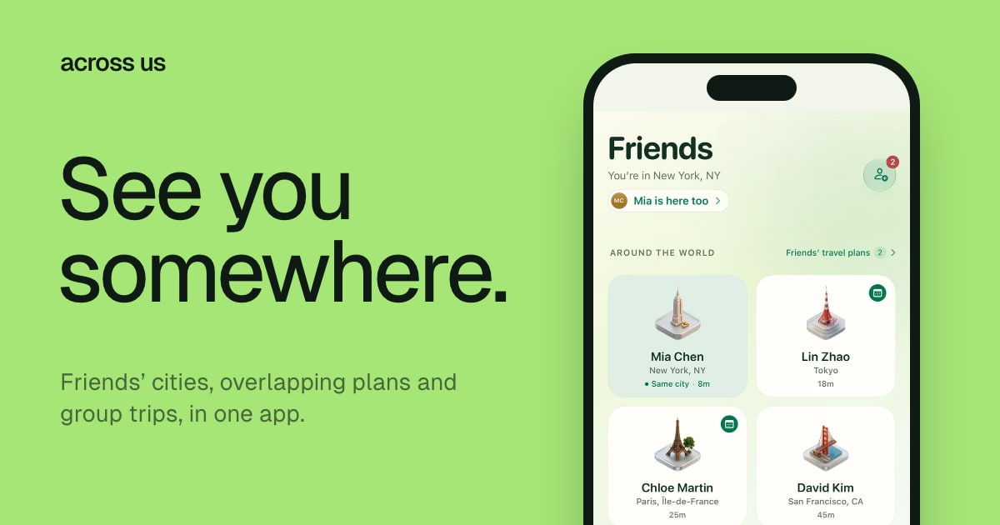
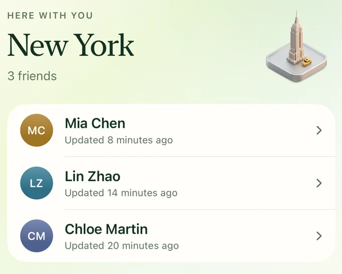
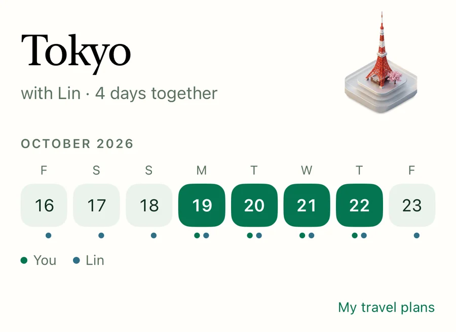
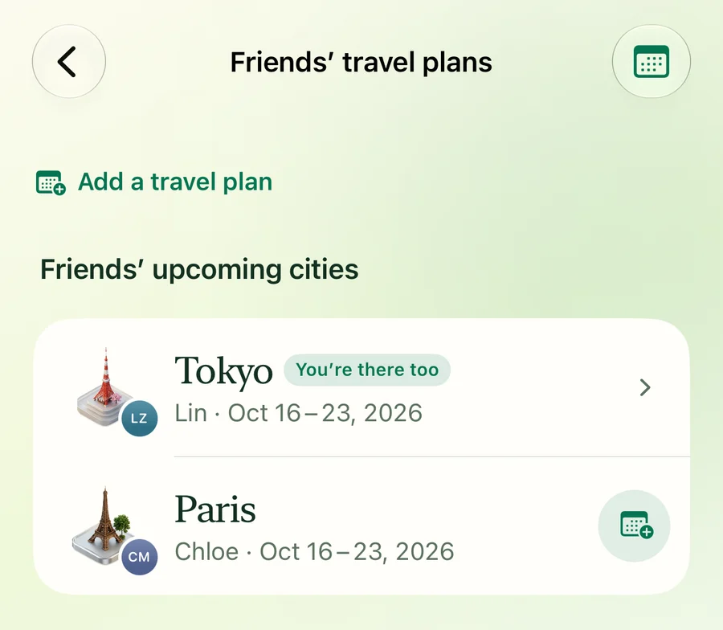
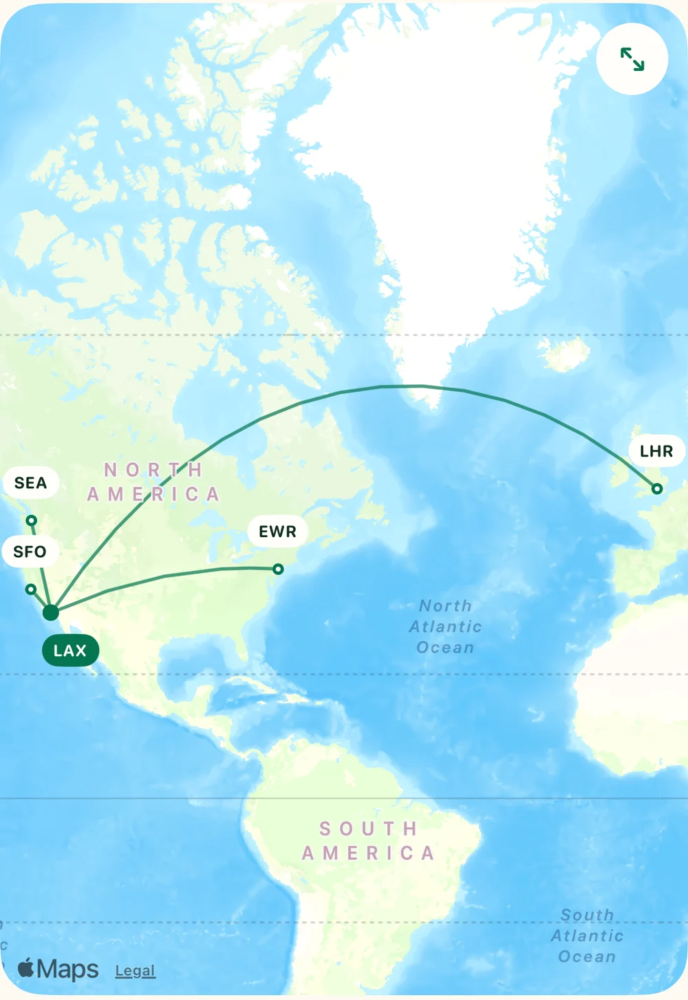
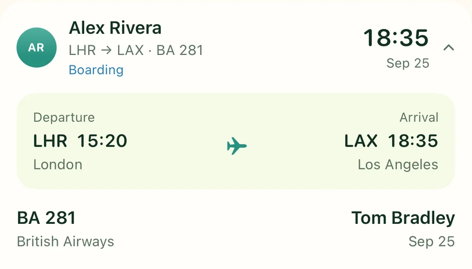
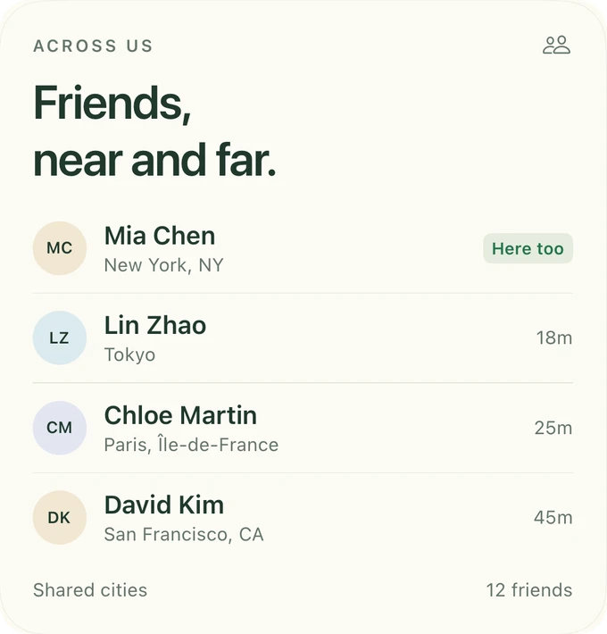
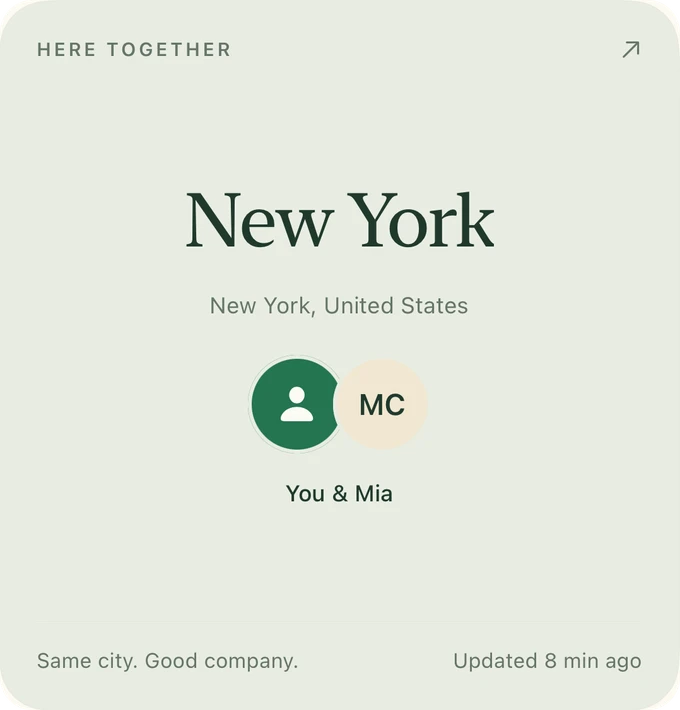

<div align="center">


# Across Us

**到时见。**

朋友在哪座城市、谁的计划刚好重叠、一起出发的行程，都在一个安静的 iPhone App 里。

<a href="https://apps.apple.com/app/apple-store/id6807634842?pt=128897130&ct=github_readme&mt=8"></a>
<a href="https://acrossus.app"></a>


<sub><a href="README.md">English</a> · <b>简体中文</b></sub>

<br>



<br><br>


<sub>200 多座城市，每座都有自己的城市徽章。</sub>

</div>

<br>

## 朋友总在路上。

Across Us 把朋友的城市、计划和航班放在一起，别让见面的机会悄悄错过。没有实时地图，没有 GPS 轨迹：只有朋友选择分享的城市，以及分享的时间。

<table>
  <tr>
    <td width="33%" valign="top">
      
      <h3>同城同时</h3>
      看看谁和你在同一座城市，并决定谁可以触发同城提醒。
    </td>
    <td width="33%" valign="top">
      
      <h3>计划重叠</h3>
      计划重叠时，直接看到你们会同时在那里的日子。
    </td>
    <td width="33%" valign="top">
      
      <h3>下一站</h3>
      朋友分享城市和日期，你就知道他们接下来要去哪。
    </td>
  </tr>
</table>

## 从各地出发，在一处汇合。

邀请朋友加入一个 **Trip**，所有人的航班和到达时间都在一个地方。

<p align="center">
  
  &nbsp;
  
</p>

- **每趟航班，细到航站楼。** 起降时间、航空公司、航站楼和实时状态。每位旅伴管理自己的航班。
- **需要时轻轻提醒。** 航班变动提醒、早间提醒，还能一键提醒还没添加航班的朋友。
- **计划可以改变。** 成员可以退出；创建者可以移除成员或删除 Trip。

## 放在主屏幕上。

<p align="center">
  <picture>
    <source media="(prefers-color-scheme: dark)" srcset="site/assets/product/friends-dark.webp">
    
  </picture>
  &nbsp;
  <picture>
    <source media="(prefers-color-scheme: dark)" srcset="site/assets/product/here-together-dark.webp">
    
  </picture>
</p>

## 隐私优先。

<table>
  <tr>
    <td width="50%" valign="top">
      <h3>🏙️ 只到城市，不到坐标</h3>
      由 Apple 定位服务解析城市。精确坐标不会发送到我们的服务器，也没有连续的 GPS 轨迹。
    </td>
    <td width="50%" valign="top">
      <h3>🤝 双方同意</h3>
      好友关系需要双向确认。你可以逐个好友决定谁能看到你的城市和计划，并随时暂停分享。
    </td>
  </tr>
  <tr>
    <td width="50%" valign="top">
      <h3>🚫 无广告，不追踪</h3>
      不展示广告，不跨 App 追踪，不出售个人数据。
    </td>
    <td width="50%" valign="top">
      <h3>🗑️ 随时删除</h3>
      在 App 内移除好友、屏蔽用户或删除账号。
    </td>
  </tr>
</table>

完整隐私政策：[acrossus.app/privacy](https://acrossus.app/privacy/)

---

## 技术栈

| 层 | 技术 |
| --- | --- |
| **App** | SwiftUI · WidgetKit（小、中、大三种尺寸）· iOS 18+ · 英文与简体中文 |
| **后端** | Supabase Postgres 与版本化迁移 · Edge Functions：`api`、`push-worker`、`trip-worker`、`ops-monitor` |
| **通知** | APNs，经 outbox 按设备投递并自动重试 |
| **航班** | AeroDataBox 查询与状态刷新 |
| **网站** | [acrossus.app](https://acrossus.app) 部署在 Cloudflare Pages，邀请链接与 Universal Links 由 Pages Functions 处理 |
| **CI** | GitHub Actions：后端测试、Debug / Staging / Release 构建、单元测试 |

```text
WhereIsMyFriend/          SwiftUI App：App、Core、Features（Friends、Trips、TravelPlans 等）
WhereIsMyFriendWidget/    WidgetKit 扩展
WhereIsMyFriendTests/     单元测试
WhereIsMyFriendUITests/   UI 测试
supabase/                 迁移、Edge Functions、seed、后端测试
site/  functions/         acrossus.app 及其 Pages Functions
docs/                     设计规范、API 合同、发布记录、评审
```

## 本地运行

需要 **Xcode 27**（iOS 27 SDK）。App 支持 iOS 18 及以上。

1. 打开 `WhereIsMyFriend.xcodeproj`。
2. 选择 **WhereIsMyFriend** scheme 和任意 iPhone 模拟器。
3. Build & Run。

Debug 构建使用本地 Demo 数据，无需服务器即可完整使用 App。加上启动参数 `-useRemoteAPI` 可改为连接已配置的后端。

```bash
npm ci && npm run backend:test
```

```bash
xcodebuild -project WhereIsMyFriend.xcodeproj -scheme WhereIsMyFriend \
  -sdk iphonesimulator -destination 'generic/platform=iOS Simulator' \
  CODE_SIGNING_ALLOWED=NO build
```

<details>
<summary><b>延伸阅读</b></summary>

<br>

- [设计规范](docs/DESIGN_SPEC.md)
- [客户端架构决策](docs/ADR-001-CLIENT-BOUNDARY.md)
- [REST API 合同](docs/API_CONTRACT.md)
- [数据库 schema](docs/DATABASE_SCHEMA.sql)
- [Supabase 生产部署计划](docs/SUPABASE_PRODUCTION_PLAN.md)
- [可选：本地 Supabase 后端](docs/LOCAL_BACKEND.md)
- [TestFlight 发布](docs/TESTFLIGHT_RELEASE.md)
- [产品计划](PLAN.md)

</details>

<br>

<div align="center">


**朋友就在某处。为下一次重逢留个位置。**

<sub>[官网](https://acrossus.app) · [App Store](https://apps.apple.com/app/apple-store/id6807634842?pt=128897130&ct=github_readme&mt=8) · [隐私政策](https://acrossus.app/privacy/) · [支持](https://acrossus.app/support/)</sub>

<sub>© 2026 Across Us</sub>

</div>
